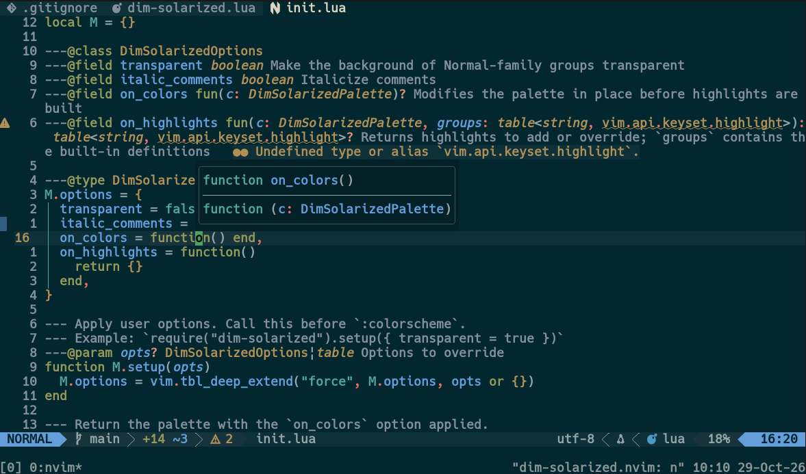
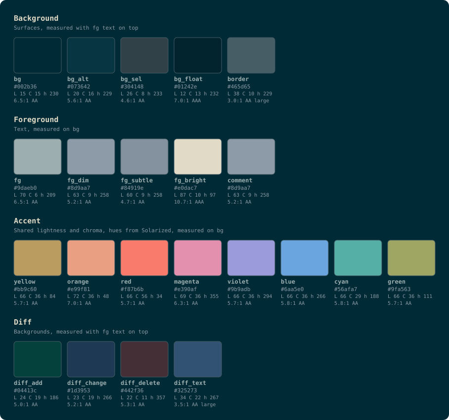

# dim-solarized.nvim

A Solarized-based Neovim colorscheme with the original Solarized dark background and lower lightness and chroma, so it's easier on the eyes. Dark only.



## :sparkles: Features

- A shared lightness and chroma for the 8 accents, except orange and magenta (slightly lighter), red (more chroma), and cyan (less chroma), which are adjusted to tell them apart (5.7-7.0:1 contrast against the background)
- Body text and comments are lighter than in the original for readability (comment contrast goes from 2.8:1 to about 5.2:1)
- The palette is computed from CIE LCh (`lua/dim-solarized/palette.lua`)
- Covers Tree-sitter, LSP semantic tokens, diagnostics, diff, and the 16 `:terminal` colors

## :clipboard: Requirements

- Neovim 0.12.5 or later (tested on 0.12.5; older versions may not work)
- A terminal with 24-bit color support (`vim.o.termguicolors = true`)

## :package: Installation

Install with [lazy.nvim](https://github.com/folke/lazy.nvim):

```lua
{
	"pitahashi/dim-solarized.nvim",
	lazy = false,
	priority = 1000,
	opts = {},
}
```

`lazy = false` and `priority = 1000` ensure the colorscheme loads before your other plugins.

## :rocket: Usage

```lua
vim.cmd([[colorscheme dim-solarized]])
```

```vim
colorscheme dim-solarized
```

`setup()` is optional. Without it, the defaults are used.

You can also read the full docs inside Neovim with `:help dim-solarized`.

## :wrench: Configuration

> Configure the colorscheme **BEFORE** loading it. If you call `setup()` afterwards, the options won't take effect until you run `colorscheme dim-solarized` again.

lazy.nvim passes `opts` to `setup()` for you. Otherwise, call it yourself:

```lua
require("dim-solarized").setup({
	transparent = false, -- transparent backgrounds for Normal, NormalFloat, etc.
	italic_comments = true, -- italic comments
	on_colors = function(c) end, -- edit the palette in place (see below)
	on_highlights = function(c, groups) -- add or override highlight groups (see below)
		return {}
	end,
})
```

| Option | Type | Default | Description |
| --- | --- | --- | --- |
| `transparent` | `boolean` | `false` | Make the backgrounds of `Normal`, `NormalFloat`, etc. transparent |
| `italic_comments` | `boolean` | `true` | Italicize comments |
| `on_colors` | `fun(c)` | no-op | Modify the palette `c` in place before highlights are built |
| `on_highlights` | `fun(c, groups): table` | function returning `{}` | Add or override highlight groups |

## :art: Overriding Colors & Highlight Groups

`on_colors` gets the palette `c` and edits it in place. The changes carry over to the highlight groups, the `:terminal` colors, and the bundled statusline theme.

```lua
require("dim-solarized").setup({
	on_colors = function(c)
		c.bg = "#001f27"
	end,
})
```

`on_highlights` gets the palette `c` (after `on_colors`) and the built-in definitions `groups`. It returns a table of `group name = nvim_set_hl definition`.

```lua
require("dim-solarized").setup({
	on_highlights = function(c)
		return {
			CursorLine = { bg = c.bg_sel },
			["@comment.todo"] = { fg = c.orange, bold = true },
		}
	end,
})
```

Notes:

- A returned group replaces the built-in definition entirely; attributes are not merged. If you only want to change `fg`, repeat any `bg` or `bold` you want to keep.
- Returned values are applied last, so they win over `transparent`.

These are the main keys in `c`:

| Key | Purpose |
| --- | --- |
| `bg`, `bg_alt`, `bg_sel`, `bg_float` | Normal background, cursor line and similar, selection, floating windows |
| `fg`, `fg_dim`, `fg_bright` | Normal, secondary, and emphasized foreground |
| `comment`, `border` | Comments, borders |
| `yellow`, `orange`, `red`, `magenta`, `violet`, `blue`, `cyan`, `green` | The 8 accents |
| `diff_add`, `diff_change`, `diff_delete`, `diff_text` | Diff backgrounds |



The colors are defined in `lua/dim-solarized/palette.lua`.

## :mag: Troubleshooting

- Colors aren't applied: make sure `setup()` runs before `colorscheme` and that `termguicolors` is on.
- Colors from another colorscheme show through: make sure `lazy = false` and `priority = 1000` are set in lazy.nvim.
- `:colorscheme` always sets `background` to `dark`. There is no light variant.

## :robot: about using AI

This project was built with the help of AI (Claude, by Anthropic). The code, documentation, and palette were AI-generated and may contain bugs or unexpected behavior. Please review the code before relying on it, and report any problems by opening an issue.

## :page_facing_up: License

[MIT](LICENSE)

## :pray: Acknowledgements

The color design is based on [Solarized](https://ethanschoonover.com/solarized/) by Ethan Schoonover (MIT License). This is an independent project and is not affiliated with the original. Solarized's license notice is included in [LICENSE](LICENSE).

## :hammer: Development

The palette image is generated from `palette.lua`. Regenerate it whenever you change the palette.

```sh
nvim -l scripts/gen_palette.lua
```

Run the tests (contrast checks, loading, options, help file):

```sh
nvim -l tests/run.lua
```
